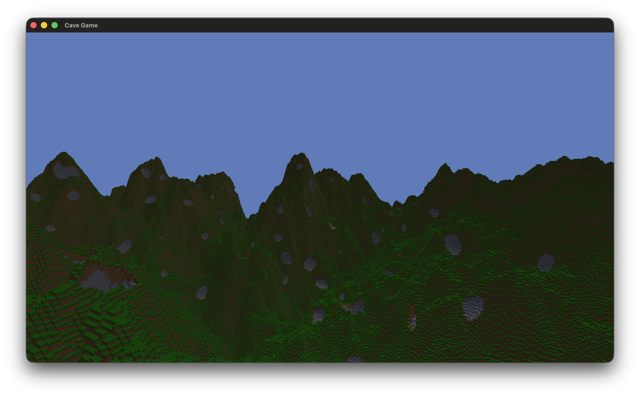

# Cave Game

A voxel game project recreating a Minecraft Alpha-style game with modern GPU rendering techniques. This is built with my Vulkan based rendering framework, [GRF](https://github.com/hippgroot/GRF).

## More to read

- [docs](docs/index.md)
- [building cave game](docs/building/index.md)
- [architecture](docs/architecture.md)

## Project Organization

| __folder__       | __target__      | __usage__                                                              |
| ---              | ---             | ---                                                                    |
| `assets`         |                 | shaders, textures, fonts                                               |
| `client`         | `cave-game`     | the playable executable: `main.cpp`, `App` (menus, input, settings), `Mesher` |
| `engine/core`    | `engine-core`   | `Channel`, `JobPool`, `Random`, `MeshData`, logging and math typedefs |
| `engine/render`  | `engine-render` | `Renderer`, `Camera`, `Assets`, `Graveyard`                            |
| `game`           | `game`          | `Game`, `Player`, `World`, `Chunk`, `Block`                            |
| `external`       |                 | submodule dependencies (GRF, FastNoiseLite)                            |
