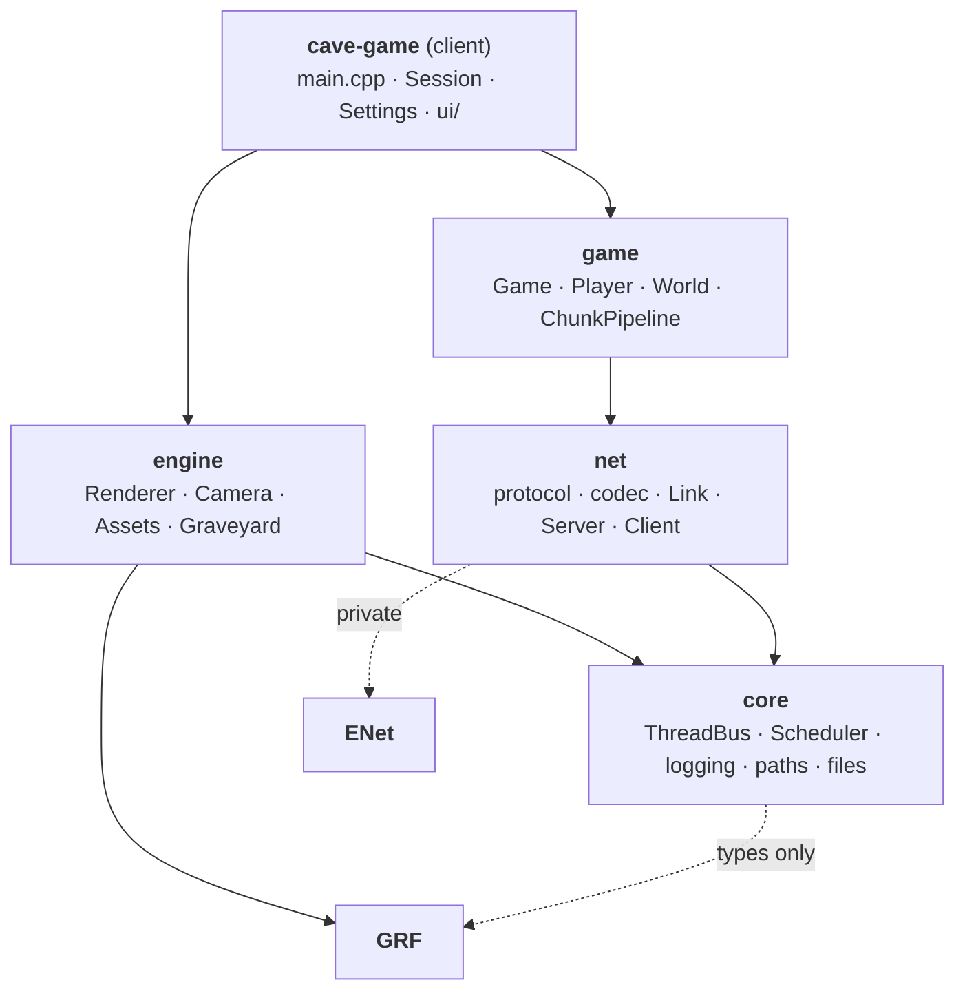
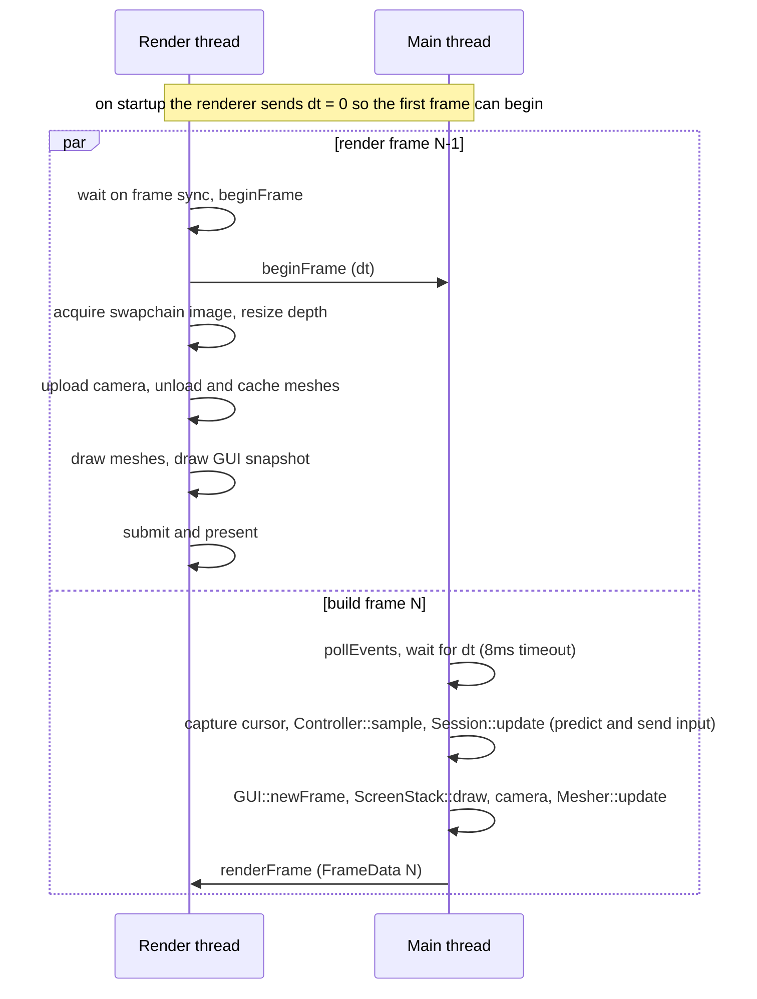
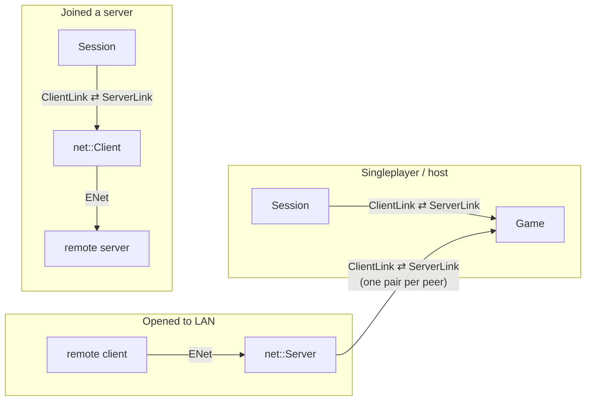

# Architecture

- [docs home](index.md)
- [readme](../README.md)

> Menus, settings, world and server lists, the integrated server, LAN/remote networking, staged world generation, chunk streaming, the spectator player, and client-side meshing work. See [planned](#planned) for what comes next.

## Modules

Every module lives in `src/<module>/` and is its own static library. The include root is `src/`, so headers are always included by module path (`#include "net/link.hpp"`).



| __folder__    | __target__                    | __contents__                                                                 |
| ---           | ---                           | ---                                                                          |
| `src/core`    | `core` (`CaveGame::core`)     | `ThreadBus` and `Channel`, `Scheduler` and `Task`, logging, `paths`, `files::writeAtomic`, type aliases, `overloaded` |
| `src/engine`  | `engine` (`CaveGame::engine`) | `Renderer`, `Camera`, `Assets` and `Registry`, `Graveyard`, `MeshData`       |
| `src/net`     | `net` (`CaveGame::net`)       | wire protocol, binary codec, `Link`, `Address`, ENet `Server` and `Client`   |
| `src/game`    | `game` (`CaveGame::game`)     | `Game`, the authoritative fixed-tick simulation, the [player](player.md) and its state machine, and the [world](world.md): `Chunk`, `World`, `ChunkPipeline` and its stages |
| `src/client`  | `cave-game` (executable)      | `main.cpp`, `Session`, `ClientWorld`, `Mesher`, `PlayerPrediction`, `Controller`, `Settings`, `WorldSave`, `ServerList`, and the [UI](ui.md) |

`game` must never depend on `engine` or `client`. It only knows about `core` and `net`, which keeps the door open for a headless dedicated server that links `game` without a window or GPU.

## Core

### Thread bus

`ThreadBus` is a singleton (reached through the `THREAD_BUS` macro) that owns every cross-thread `Channel`. A channel is registered with a payload type and referred to by its `ChannelID` from then on:

```cpp
ChannelID id = THREAD_BUS.registerChannel<f32>();
THREAD_BUS.send<f32>(id, dt);
std::optional<f32> next = THREAD_BUS.receive<f32>(id);
std::optional<f32> waited = THREAD_BUS.wait_to_receive<f32>(id, stopToken, 8ms);
THREAD_BUS.unregisterChannel(id);
```

`Channel<T>` is an unbounded mutex-guarded queue with a condition variable. `receive` polls and returns `std::nullopt` when empty. `wait_to_receive` parks until a message arrives, the stop token fires, or the optional timeout expires.

Channels are held by `shared_ptr`, so a thread that is in the middle of a send or receive keeps the channel alive even if another thread unregisters it. Sending to an unregistered ID is a no-op and receiving returns `std::nullopt`, so a dropped peer never crashes the other side.

The payload type is part of the lookup. `send` takes `std::type_identity_t<T>`, which forces the type to be written explicitly: a message sent with the wrong `T` would fail the channel's `dynamic_pointer_cast` and be dropped without an error.

### Scheduler and tasks

`Scheduler` (`core/tasks.hpp`, reached through `SCHEDULER`) owns `hardware_concurrency() - 3` worker threads (at least one), leaving cores for the main, render, and game threads. Jobs are queued in a `std::map` keyed by `TaskID = (priority << 32) | sequence`, so the lowest priority value runs first and equal priorities run in submission order. `submit`, `withdraw`, and `updatePriority` are each one locked map operation.

`Task<T>` is the handle you normally use:

```cpp
Task<Result> task([chunks] { return generate(chunks); }, priority);
task.updatePriority(newPriority);
if (auto result = task.take()) use(*result);
task.cancel();
```

- The handle and the job share a `shared_ptr` state, so a `Task` is movable and destroying one never leaves a running job writing into freed memory.
- `take()` returns the result once the job has completed and empties the handle.
- `cancel()` withdraws a job that hasn't started and returns `true`. If the job is already running it returns `false` and keeps the handle, so the result can still be collected. `~Task` cancels.
- `updatePriority` only affects jobs that are still queued.
- `T` must be a value type; there is no `Task<void>`.

### Logging

`logging::Category` objects (`core`, `net`, `game`, `client`, `render`) each carry their own level and expose `trace` through `error` with `std::format` syntax. Every thread wraps its body in a `logging::ThreadScope`, which names the thread in log output and logs its uptime on exit. Levels are configured at startup from the `CAVE_LOG` environment variable; see [running](building/index.md#logging).

### Paths and files

`paths::config()` and `paths::saves()` resolve the per-user config directory for each OS. `files::writeAtomic` writes to `<file>.tmp` and renames it over the target, so a crash mid-save never leaves a half written file. Every YAML file the client saves goes through it.

## Threads

| __thread__   | __owner__     | __lifetime__                 | __job__                                                      |
| ---          | ---           | ---                          | ---                                                          |
| `main`       | `main()`      | whole program                | window events, ImGui, the screen stack, `Session::update`, building `FrameData` |
| `render`     | `Renderer`    | whole program                | renders frame N-1 while `main` builds frame N                |
| `game`       | `Game`        | while hosting a world        | fixed 20 tick-per-second simulation                          |
| `worker-N`   | `Scheduler`   | from first use to exit       | runs `Task` jobs: chunk generation stages and chunk meshing  |
| `net-server` | `net::Server` | while a world is open to LAN | ENet host relaying remote players into `Game`                |
| `net-client` | `net::Client` | while joined to a server     | ENet peer relaying the session to a remote server            |

The names in the first column are the names that appear in log lines.

## A frame

The main thread and the render thread are pipelined one frame apart through two channels created in `main()`:

| __channel__          | __from__ | __to__ | __payload__                                                      |
| ---                  | ---      | ---    | ---                                                              |
| `beginFrameChannel`  | render   | main   | `f32` dt of the frame the renderer just started                  |
| `renderFrameChannel` | main     | render | `Renderer::FrameData`: GUI snapshot, camera, added and removed meshes |



The main thread waits for `dt` with an 8 ms timeout and loops back to `pollEvents` if it doesn't arrive, so the window stays responsive while the renderer is blocked (for example while the window is minimized).

`FrameData` is a self-contained snapshot. The GUI draw lists are deep-copied by `GUI::snapshot()`, and camera matrices and mesh data are moved in by value, so the render thread never reads main-thread state. The renderer draws the GUI with `GUI::render(cmd, snapshot)`; the overload without a snapshot would call `ImGui::Render()` on the render thread while the main thread is inside the next `NewFrame`, which is a data race on the ImGui context.

## Sessions and connections

A `Session` is the client side of one game. It owns a `net::ClientLink` and is the only thing the rest of the client talks to. Whether the game is local or remote is decided entirely by what is on the other end of the link.

`net::Link<Out, In>` is a pair of `ThreadBus` channels plus a shared `open` flag. `net::makeLinkPair()` returns a `ClientLink` (sends `ClientMessage`, receives `ServerMessage`) and the matching `ServerLink`. Either end can `close()` the link, and the channels are unregistered when the last end is destroyed. Both sides drain any queued messages before treating a closed link as a disconnect.



- `Session::singleplayer` creates a `Game`, hands it the `ServerLink` through `Game::connect`, and sends `Hello`.
- `Session::join` creates a `net::Client` that holds the `ServerLink` and relays it to the remote server over ENet, then sends `Hello`. The session code is identical in both cases.
- `Session::openToLan` starts a `net::Server` on the game's join channel. Every ENet connection gets its own link pair, and the `ServerLink` is pushed into `Game`'s join channel exactly like a local player's, so `Game` can't tell local and remote players apart.

`Session::update` drains the link once per frame and returns `Joined` when the `Welcome` arrives and `Ended` on `Disconnected` or a closed link. `main()` clears the menus on `Joined`, and on `Ended` destroys the session and shows the disconnect reason over the main menu.

The wire protocol and the handshake are described in [networking](networking.md).

## Game

`Game` runs its own thread at `Game::tickRate` (20) ticks per second. If it falls more than 10 ticks behind it logs `Can't keep up!` and skips ahead rather than trying to catch up. Each tick runs, in order:

1. `acceptPeers` takes new `ServerLink`s from the join channel.
2. `receive` handles every queued message from every peer and marks peers whose link closed.
3. `expirePeers` kicks peers that haven't sent `Hello` within `handshakeTimeout` (5 seconds).
4. `removePeers` drops leaving peers and broadcasts `PlayerLeft`.
5. `simulate` steps each player once per queued `PlayerInput` and moves its `chunkCenter` with it; see [player](player.md#server).
6. `updateWorld` gives the world one `ChunkLoader` per joined player and advances the [generation pipeline](world.md#generation-pipeline).
7. `streamChunks` sends each player the completed chunks in its view and unloads the ones that left it.
8. `sync` sends every joined player a `TickSync` and a `PlayerSync`.

Destroying `Game` stops the thread and sends `Disconnected{"Server closed"}` to every remaining peer.

## Renderer

`Renderer` owns the render thread and every GPU resource the game creates. It keeps two frames in flight, with a ring of command buffers, syncs, and per-frame globals buffers.

- `Assets` loads block textures listed in `assets/blocks.yaml` into a bindless texture lookup buffer, and compiles every `.vert` and `.frag` under `assets/shaders/` at startup.
- Meshes arrive as renderer-agnostic `MeshData` (vertex bytes, indices, optional aux buffer, push constants, AABB, pipeline name, `MeshID`, layer) and are cached by `MeshID`. Each frame the cache is frustum culled and sorted into a render buffer.
- `Graveyard` holds retired buffers and images until no in-flight frame can still reference them.
- Pipelines are created by name in `Renderer::createPipelines`: `chunk_draw` (opaque, depth write, back-face culling) and `chunk_translucent` (blended, no depth write, no culling), both from `assets/shaders/chunk_draw/`. A mesh's `layer` sorts it before or after other layers, and layers with bit 3 set (8 and up) are drawn back to front.

## Planned

- **Rendering.** Ambient occlusion and lighting in the mesher, a packed vertex format, and greedy meshing.
- **World.** Aquifers, ravines, lakes, vegetation, and structures as further stages, and saving chunks to disk.
- **More player states.** Creative and survival states with collision, other players' positions sent to each client, and redundant input packets to hide loss.
- **Renderer passes.** Per-frame scene parameters and a list of passes (sky and atmosphere first).
