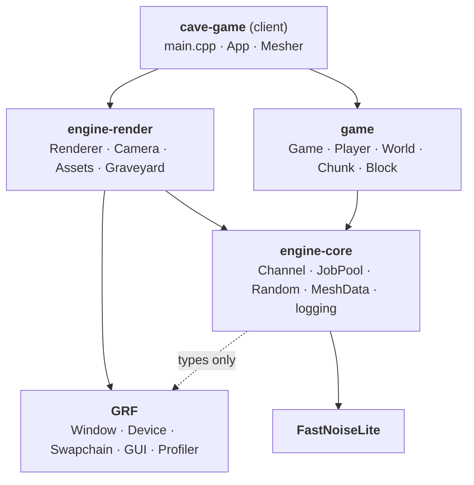
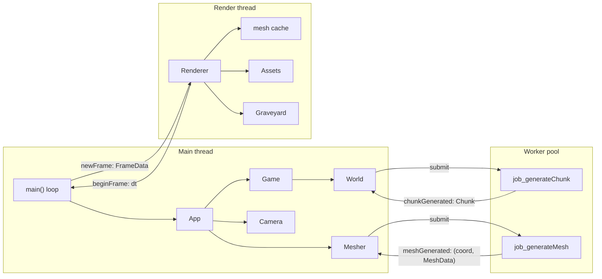
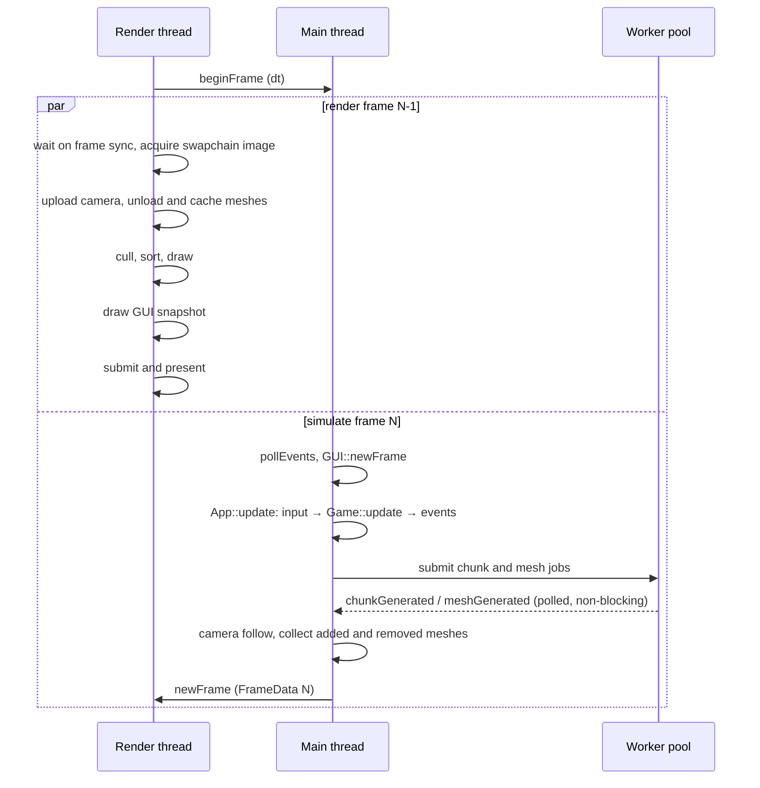

# Architecture

- [docs home](index.md)

The project is split into three layers that only depend downward. `game` knows nothing about the GPU, the window, or input devices, and `engine-render` knows nothing about chunks or blocks. `client` is the only place where the two meet.

## Foundation

Everything sits on GRF, which owns GPU resources and rendering, and two small threading primitives in `engine-core`.

`Channel<T>` is a mutex-guarded queue with a condition variable. A producer calls `send(T)`. A consumer either polls with `receive()` (returns `std::nullopt` when empty, used once per frame) or parks on `block_and_receive(stop_token)` (used by the render thread to wait for the next frame). Every cross-thread handoff in the app goes through one of these, so no other object needs a lock.

`JobPool` owns `hardware_concurrency() - 2` worker threads that pull `std::function<void()>` jobs from a queue and sleep when it is empty. Jobs report results by sending through a `Channel` that was passed in by reference. All channels and the `Random` instance are created in `main()` before the pool and outlive it, so jobs may only capture references to those; anything with a shorter lifetime (the `World`, the `Mesher`) must be captured by value or not at all.

`Random` owns the seeded generator and the noise objects. It lives in one place because constructing random devices and noise state is not free.

## Threads and channels

Three groups of threads run at once and communicate through channels.

| __channel__      | __from__     | __to__        | __payload__                                             |
| ---              | ---          | ---           | ---                                                     |
| `beginFrame`     | render       | main          | `f32` dt of the frame that just started                 |
| `newFrame`       | main         | render        | `Renderer::FrameData`: GUI snapshot, camera, added and removed meshes |
| `chunkGenerated` | worker       | main (`World`) | `Chunk` (coord + blocks)                               |
| `meshGenerated`  | worker       | main (`Mesher`) | `(ivec2, MeshData)`                                   |

## A frame

The main thread and the render thread are pipelined one frame apart. The render thread hands out `dt` as soon as it starts a frame, then renders the previous frame's snapshot while the main thread simulates the next one.

`FrameData` is a self-contained snapshot. The GUI draw lists are cloned by `GUI::snapshot()`, the camera matrices are computed on the main thread, and mesh data is moved in by value, so the render thread never reads main-thread state directly. The renderer draws the GUI with `GUI::render(cmd, snapshot)`; the single-argument overload would call `ImGui::Render()` on the render thread while the main thread is already inside the next `NewFrame`, which is a data race on the ImGui context.

## Life of a chunk

```mermaid
flowchart LR
  A["World::requestChunks<br/>cache[coord] = nullopt"] -- "submit" --> B["job_generateChunk<br/>noise → blocks"]
  B -- "chunkGenerated" --> C["World::receiveChunks<br/>cache[coord] = chunk<br/>addedChunks += coord"]
  C --> D["Game::update<br/>ChunkLoadEvent{ copy }"]
  D --> E["App::update<br/>idCache[coord] = 0<br/>Mesher::newMesh(move)"]
  E -- "submit" --> F["job_generateMesh<br/>faces → MeshData"]
  F -- "meshGenerated" --> G["App::update<br/>idCache[coord] = meshID<br/>addedMeshes += MeshData"]
  G -- "newFrame" --> H["Renderer::cacheMeshes<br/>vertex / index / aux buffers"]
```

1. Each frame `World::update` compares the player's chunk coordinate with the last one. On a change it erases chunks beyond `viewDistance + 2`, then requests every missing coordinate inside `viewDistance`, nearest first. A requested coordinate is stored as `std::nullopt` immediately so it is never requested twice.
2. A worker builds an `18 × 18 × 256` block volume (one block of padding on each side so faces on the chunk border can be culled without neighbor lookups) and sends the `Chunk` back.
3. `World` keeps the chunk in its cache and records the coordinate. `Game` turns that into a `ChunkLoadEvent` holding a copy of the chunk. This is the only copy on the path: the world needs to keep its blocks, and the mesh job needs its own.
4. `App` skips coordinates it has already seen, marks the coordinate with `MeshID` 0 (meaning "mesh in flight"), and moves the chunk into a mesh job. The `MeshID` is taken on the main thread so no worker ever touches the counter.
5. The worker emits one quad per exposed face, packs the vertices into bytes, and sends `(coord, MeshData)` back.
6. `App` records the real `MeshID` and queues the `MeshData` for the next `FrameData`. If the chunk was unloaded while the mesh was in flight, the result is dropped here.
7. The render thread creates the GPU buffers and inserts the mesh into its cache under the `MeshID`.

Unloading runs the same path in reverse: `World` erases the entry and records the coordinate, `Game` emits a `ChunkUnloadEvent`, `App` looks up the `MeshID` and queues it in `removedMeshes`, and the renderer retires the buffers to the `Graveyard`, which frees them once no in-flight frame can still reference them.

## Key types

| __type__              | __owner__       | __role__                                                                   |
| ---                   | ---             | ---                                                                        |
| `Game::Input`         | `game`          | per-frame movement, look deltas, and view distance; the only way into the simulation |
| `Game::Event`         | `game`          | `std::variant<ChunkLoadEvent, ChunkUnloadEvent>`; the only way out         |
| `MeshData`            | `engine-core`   | renderer-agnostic mesh payload: bytes, indices, aux, push constants, AABB, pipeline name, `MeshID`, layer |
| `Renderer::FrameData` | `engine-render` | everything the render thread needs for one frame                           |
| `Camera::UpdateData`  | `engine-render` | frustum plus the matrices uploaded to the camera buffer, only produced when the camera moved |
