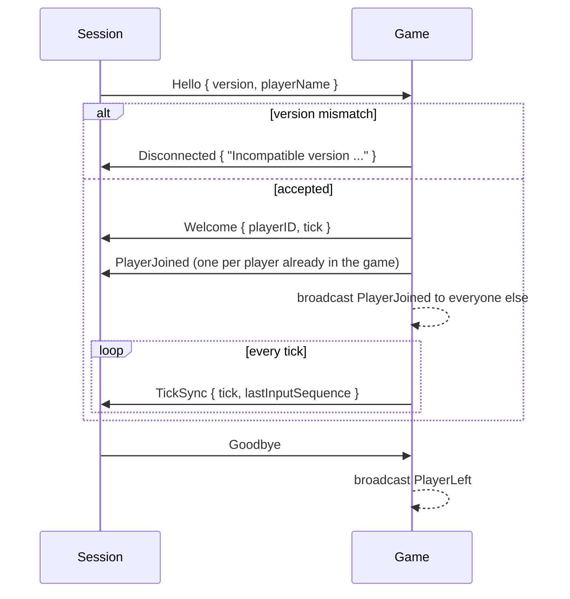

# Networking

- [docs home](index.md)
- [architecture](architecture.md)

Every player, local or remote, talks to `Game` through the same message protocol. In singleplayer the messages are moved through `ThreadBus` channels without being serialized. For LAN and remote play, a relay thread on each side encodes them into ENet packets. See [sessions and connections](architecture.md#sessions-and-connections) for how the pieces are wired.

## Protocol

Messages are plain structs in `src/net/protocol.hpp`, grouped by direction into two variants:

```cpp
using ClientMessage = std::variant<Hello, PlayerInput, Goodbye>;
using ServerMessage = std::variant<Welcome, TickSync, PlayerJoined, PlayerLeft, Disconnected>;
```

| __message__    | __direction__   | __delivery__ | __fields__                                   | __meaning__                                      |
| ---            | ---             | ---          | ---                                          | ---                                              |
| `Hello`        | client → server | reliable     | `version`, `playerName`                      | first message on every connection                |
| `PlayerInput`  | client → server | unreliable   | `sequence`, `move`, `pitch`, `yaw`, `buttons` | latest input; older sequences are ignored       |
| `Goodbye`      | client → server | reliable     |                                              | the player quit                                  |
| `Welcome`      | server → client | reliable     | `playerID`, `tick`                           | handshake accepted                               |
| `TickSync`     | server → client | unreliable   | `tick`, `lastInputSequence`                  | sent every tick to every joined player           |
| `PlayerJoined` | server → client | reliable     | `id`, `playerName`                           | another player is in the game                    |
| `PlayerLeft`   | server → client | reliable     | `id`                                         | another player left                              |
| `Disconnected` | server → client | reliable     | `reason`                                     | the server is closing the connection             |

`protocol::isReliable` decides delivery; everything is reliable except `PlayerInput` and `TickSync`, which are superseded by the next one anyway.

`protocol::version` (currently `1`) is checked during the handshake. Bump it whenever the wire format of any message changes.

## Handshake



- Player names keep only printable ASCII, are cut to `protocol::maxPlayerNameLength` (16) characters, and fall back to `Player` if nothing is left.
- A peer that hasn't sent `Hello` within `Game::handshakeTimeout` (5 seconds) is kicked.
- A `Hello` after joining, or `PlayerInput` before joining, is ignored and logged.
- A closed link without `Goodbye` is treated as `connection lost`.

## Wire format

`src/net/codec.hpp` turns a message variant into bytes and back:

```
u8 variant index | field 0 | field 1 | ...
```

- Integers are little-endian at their declared width. `f32` and `f64` are bit-cast to `u32` and `u64`.
- Strings are a `u32` length followed by the bytes, capped at `net::maxStringLength` (4096).
- GLM vectors are their components in order.

Fields are found through each message's `fields()` member, which returns a `std::tie` of its members using deducing `this`, so one function serves both encoding (const) and decoding (mutable). `decode` returns `std::nullopt` for an unknown variant index, a truncated packet, an oversized string, or trailing bytes. The server disconnects a peer that sends a malformed packet.

## Transport

ENet (v1.3.18, `external/enet`) provides the UDP transport. Each host opens two ENet channels: channel 0 carries reliable messages and channel 1 unreliable ones.

| __class__     | __thread__   | __role__                                                                               |
| ---           | ---          | ---                                                                                    |
| `net::Server` | `net-server` | listens on a port, creates a link pair per connection, and pushes the `ServerLink` into `Game`'s join channel |
| `net::Client` | `net-client` | connects to a remote address (5 second timeout) and relays the session's link over the socket |

Both relays run the same loop: service ENet for up to 2 ms, decode incoming packets into the link, then encode and send everything queued on the link. When the link is closed locally they call `enet_peer_disconnect_later`, so anything already queued (for example a kick's `Disconnected` reason) is delivered before the peer drops. On shutdown they wait up to 250 ms for peers to acknowledge the disconnect.

Addresses are parsed by `net::Address::parse` as `host` or `host:port`. The default port is `net::defaultPort` (7777).

## Adding a message

1. Add a struct to `src/net/protocol.hpp` with a `static constexpr std::string_view name` and a `fields()` member that ties every serialized member. Field types must be integers, `f32`, `f64`, `str`, or GLM vectors.
2. Append it to `ClientMessage` or `ServerMessage`. Appending keeps existing variant indices stable; inserting in the middle changes them.
3. If it is safe to drop, add it to the unreliable list in `isReliable`.
4. Bump `protocol::version`.
5. Handle it: add a `Game::handle` overload for client messages, or a case in `Session::update` for server messages. Both use `std::visit`, so a missing handler is a compile error.
