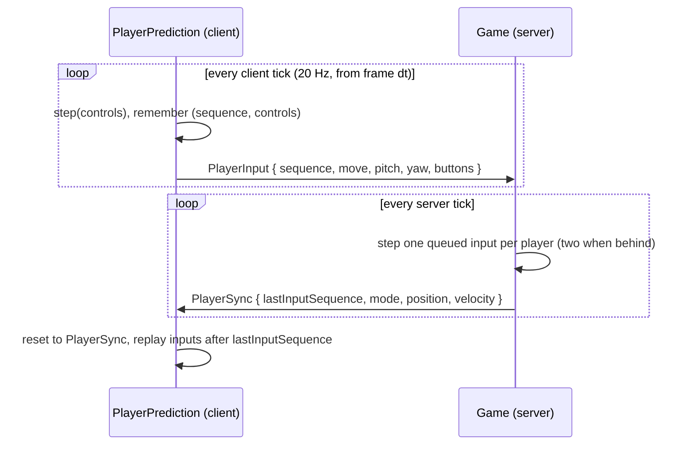

# Player

- [docs home](index.md)
- [architecture](architecture.md)
- [networking](networking.md)

The server owns every player's position. Each client runs the same simulation locally to predict its own player, so the camera responds immediately, and quietly corrects itself whenever the server disagrees.

## Shared simulation

`Player` (`src/game/player/player.hpp`) lives in `game`, so the server and the client's prediction run identical code.

| __type__     | __role__                                                                     |
| ---          | ---                                                                          |
| `PlayerBody` | position (feet), velocity, pitch, yaw, and `forward()`/`right()` on the horizontal plane |
| `Controls`   | one tick of intent: `move` (x strafe, y forward, each -1..1), absolute `pitch`/`yaw` in radians, and a `Button` bitmask |
| `Player`     | a body plus the current state; `step(controls, dt)` advances one tick        |
| `PlayerMode` | which state the player is in, sent over the wire as a `u8`                   |

`Player::step` first sanitizes the controls: non-finite values become 0, `move` is clamped to -1..1, pitch is clamped to ±89.9°, and yaw is wrapped. It then runs the state and clamps the position to the world border (±30,000,000 horizontally, y -1024..2048). The server runs `step` on untrusted input, so a NaN from a broken or malicious client can never reach the body.

The eye is `Player::eyeHeight` (1.62) above the body position.

### State machine

The state is a `std::variant` of state classes:

```cpp
using State = std::variant<SpectatorState>;
```

Each state is a copyable value satisfying the `PlayerState` concept:

```cpp
class SomeState {
public:
  static constexpr PlayerMode mode = PlayerMode::Some;

  void enter(PlayerBody& body) const;
  void exit(PlayerBody& body) const;
  void step(PlayerBody& body, const Controls& controls, f32 dt) const;
};
```

`setMode` calls the old state's `exit`, builds the new state with `makeState`, and calls its `enter`. A variant rather than a virtual base keeps `Player` a plain value. Prediction copies the whole player, rewinds it to the server's state, and replays inputs, and that needs copying to be cheap and complete. Per-state data (a jump timer, a fall distance) goes inside the state class, so it is copied too.

To add a state such as creative or survival:

1. Add a value to `PlayerMode` before `Count`, and a case to `toString`.
2. Write the state class in `src/game/player/<name>.hpp/.cpp`, add it to `src/game/CMakeLists.txt`, and append it to `Player::State`.
3. Add a case to `Player::makeState`.
4. If the state has data the client needs for prediction, add it to `PlayerSync` and to `PlayerPrediction::reconcile`.

### Spectator

`SpectatorState` is a free camera like Minecraft's spectator mode, with no collision:

- `move` steers horizontally along the facing direction, ignoring pitch. Diagonals are clamped so they aren't faster.
- `Jump` flies up and `Crouch` flies down.
- The target velocity is `SpectatorState::speed` (11 blocks/s). The velocity eases toward it at `response` 10 per second, `velocity += (wish - velocity) * (1 - e^(-response·dt))`, which gives a short glide when keys are released.

## Controls

`Controller` (`src/client/controller.hpp`) turns the window state into `Controls` once per frame.

| __input__   | __control__              |
| ---         | ---                      |
| W / S       | `move.y` +1 / -1         |
| D / A       | `move.x` +1 / -1         |
| Space       | `Button::Jump`           |
| Left Ctrl   | `Button::Crouch`         |
| mouse       | yaw and pitch, 0.0025 rad per pixel × `Settings::Controls::sensitivity`, `invertY` flips pitch |

`main()` captures the cursor with `grf::Window::setCursorCaptured` while the player is in game with no screen open, and sets `ImGuiConfigFlags_NoMouse` for that time so the GUI ignores the hidden cursor. When a screen opens (Escape, for example), the cursor is released and `Controller` returns zero movement while keeping the current rotation. The rotation is reset when a session starts.

## Networking



### Server

- `Game::handle(PlayerInput)` queues inputs per peer and drops any whose sequence isn't newer than the newest seen (stale or reordered packets). The queue holds at most `Game::maxQueuedInputs` (one second); beyond that the oldest is discarded.
- `Game::simulate` steps each player once per queued input, never on its own. When more than `Game::inputBuffer` (2) inputs are waiting, for example after a lag spike, it steps twice a tick to catch up. A client sending inputs too fast can therefore move at most twice as fast, and only until its queue is drained.
- Steps happen only when an input is available, so after processing sequence N the server's player is exactly what the client predicted for sequence N.
- After simulating, `chunkCenter` is set to the chunk under the player, which drives chunk loading and [streaming](world.md#streaming-to-clients).
- Players spawn in spectator mode at `(8.5, 100, 8.5)`.

### Client

`PlayerPrediction` (`src/client/player_prediction.hpp`) is owned by `Session` and created from the first `PlayerSync`.

- `advance(dt, controls)` accumulates frame time and runs one `Player::step` per `Game::tickDelta`, at most 5 per frame. Each step is kept as pending, and its `PlayerInput` is returned for `Session` to send.
- `reconcile(sync)` ignores a sync older than the last one, drops acknowledged inputs, resets a copy of the player to the synced mode, position, and velocity, and replays the remaining pending inputs on it.
- The render position interpolates between the last two predicted ticks by the leftover accumulator, so movement is smooth at any frame rate even though the simulation runs at 20 Hz.
- If reconciling moves the player, the difference goes into a correction offset that decays at 12 per second instead of snapping. A correction over 8 blocks snaps.
- Pitch and yaw for the camera come straight from the latest `Controls`, not the simulation, so looking around has no tick delay.

In singleplayer the prediction is exact and corrections are always zero. With 10% of inputs dropped, the predicted and server positions still converge exactly once the player stops, with corrections of a few tenths of a block.

### Camera

Every frame, `main()` points the engine `Camera` at `PlayerPrediction::eye()` with the latest pitch and yaw, and sends `camera.update()` in `FrameData`. The viewport and FOV are updated when the window size or `Settings::Video::fov` changes. Press F3 in game for a debug overlay showing position, chunk, facing, mode, loaded chunks, and the prediction state.

## Limitations

- Lost `PlayerInput` packets are never resent, so the server loses that tick of movement and the client gets corrected. Sending the last few inputs in each packet would hide most loss.
- Because the server only steps a player when an input arrives, a player whose inputs stop (a stalled client) freezes in place. Survival gravity will need the server to step without input after a timeout.
- Other players' positions aren't sent yet; each client only knows about itself.
- Movement has no collision; only spectator exists.
