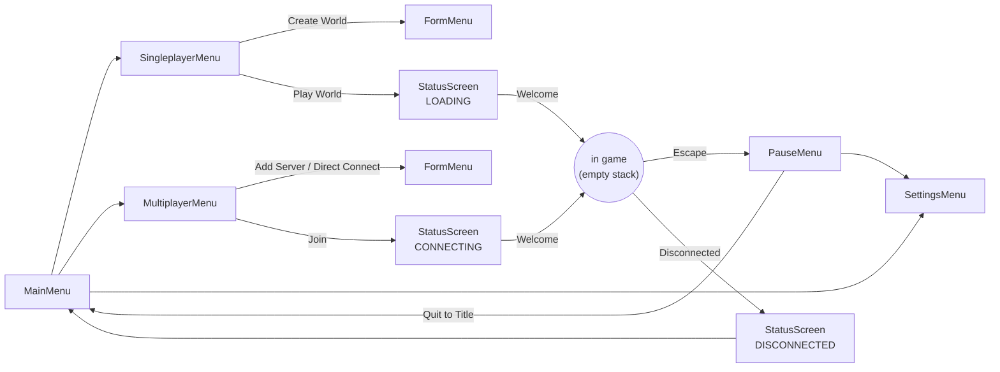

# Client UI

- [docs home](index.md)
- [architecture](architecture.md)

The game UI is drawn with ImGui on the main thread, but screens never call ImGui widgets directly. They use a small layer in `src/client/ui/` that provides a screen stack, rect-based layout, themed widgets, and animation helpers, so menus are positioned explicitly and scale with the window.

## Screen stack

A `Screen` is one full-window state of the UI (a menu, a dialog, a loading message). `ScreenStack` owns the screens and draws them bottom to top inside a single borderless ImGui window that covers the viewport.

```cpp
screens.push<SettingsMenu>(SettingsMenu::Info{ ... });
screens.replace<MainMenu>(mainMenuInfo);
screens.pop();
screens.clear();
```

- **Deferred operations.** `push`, `pop`, `replace`, and `clear` are queued and applied before and after each `draw`, so a screen can safely push or pop (including itself) from inside its own `draw`.
- **Visibility.** Drawing starts at the topmost screen whose `isOpaque()` is true. A non-opaque screen such as the pause menu draws over whatever is beneath it.
- **Input.** Only the top screen gets `ctx.interactive == true`.
- **Escape** pops the top screen unless it overrides `closesOnEscape()` to return false, or a text field has focus.
- **Lifecycle.** `onEnter`, `onExit`, `onCovered`, and `onUncovered` are called as screens are pushed, popped, and covered. `time()` is the number of seconds the screen has been visible, which drives entrance animations.
- **Game pause.** `pausesGame()` (true by default) lets the stack report whether any open screen should pause a local game.

### Context

`draw` receives a `ui::Context`:

| __field__     | __meaning__                                                          |
| ---           | ---                                                                  |
| `screens`     | the stack, for pushing and popping                                   |
| `theme`       | fonts, colors, and sizes                                             |
| `viewport`    | the full window as a `ui::Rect`                                      |
| `dt`, `time`  | frame delta and the screen's visible time                            |
| `scale`       | window height divided by `Theme::referenceHeight` (720), at least 0.5 |
| `interactive` | true only for the top screen                                         |

Write sizes in 720p pixels and wrap them in `ctx.px(...)` so the UI scales with the window.

## Building blocks

| __file__     | __provides__                                                                         |
| ---          | ---                                                                                  |
| `rect.hpp`   | `ui::Rect` with min/max, size, and translation helpers                               |
| `layout.hpp` | `anchor` a rect inside a parent at one of nine `Anchor` points; `vstack` and `hstack` to split an area into rows or columns, with `Align` |
| `widgets.hpp` | `box`, `panel`, `label`, `button`, `tab`, `listItem`, `textField`, `slider`, plus `Fade` and `IDScope` RAII guards |
| `anim.hpp`   | easing functions, `Tween` (delay, duration, easing, `staggered`), `approach` for frame-rate independent smoothing, and `smoothed` for per-ID smoothed values |
| `theme.hpp`  | `ui::Theme` colors and sizes, and `loadTheme`, which loads the Monocraft font at body and title sizes |

## Screens

| __screen__         | __file__                       | __notes__                                                         |
| ---                | ---                            | ---                                                               |
| `MainMenu`         | `screens/main_menu.*`          | Singleplayer, Multiplayer, Settings, Exit; ignores Escape         |
| `SingleplayerMenu` | `screens/singleplayer_menu.*`  | lists saved worlds; Play World, Create World                      |
| `MultiplayerMenu`  | `screens/multiplayer_menu.*`   | lists saved servers; Join Server, Direct Connect, Add Server, Remove |
| `SettingsMenu`     | `screens/settings_menu.*`      | General, Controls, Video, and Audio tabs                          |
| `PauseMenu`        | `screens/pause_menu.*`         | non-opaque; Back to Game, Open to LAN (when hosting), Settings, Quit to Title |
| `StatusScreen`     | `screens/status_screen.*`      | title, message, and one button; used for loading, connecting, and disconnect reasons |
| `ListMenu`         | `screens/list_menu.*`          | base class for scrollable, selectable lists with an action row    |
| `FormMenu`         | `screens/form_menu.*`          | text-field dialog used for Create World, Add Server, and Direct Connect |

Settings changes are applied live through the `apply` callback (window mode and vsync) and written to `settings.yaml` when the settings screen closes, if anything changed.

## Menu flow

`main()` owns the stack and wires screens together with callbacks in each screen's `Info` struct, so screens don't know about `Session` or each other.



In game, F3 toggles the GRF profiler overlay.

## Adding a screen

1. Create `src/client/ui/screens/<name>.hpp` and `.cpp` with a class deriving from `Screen` (or `ListMenu` for a list). Take callbacks and data in a nested `Info` struct.
2. Implement `draw(const ui::Context&)` with the layout and widget helpers, and override `isOpaque`, `closesOnEscape`, or `pausesGame` if the defaults don't fit.
3. Add both files to `src/client/CMakeLists.txt`; sources are listed explicitly.
4. Push it from `main.cpp` or from another screen through `ctx.screens`.
