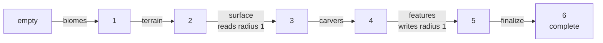
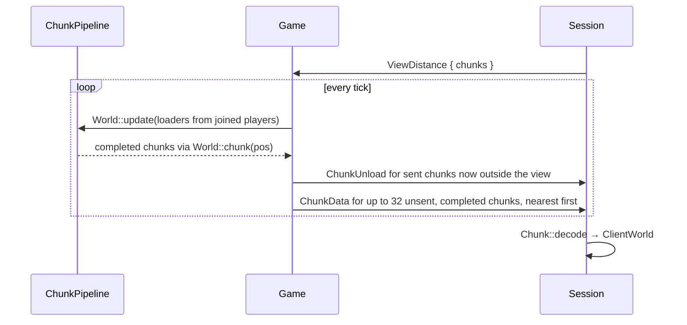
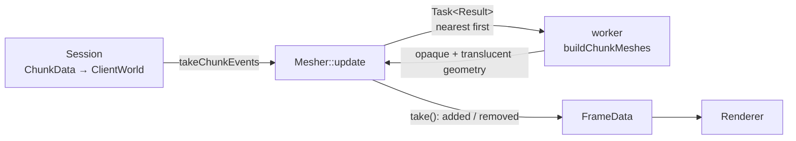

# World

- [docs home](index.md)
- [architecture](architecture.md)
- [networking](networking.md)

The world is generated on the server by a staged pipeline and streamed to clients one chunk at a time. Every client, including the host's own, keeps a replica built only from what the server sent it.

## Chunks

`Chunk` (`src/game/world/chunk.hpp`) is a `16 × 256 × 16` column of `Block`s (one byte each), stored y-major: `index = (y * 16 + z) * 16 + x`, plus one `Biome` per column. Chunks are unpadded; anything that needs a neighbour's blocks gets the neighbour itself.

Blocks are listed in `src/game/world/block.hpp` and their textures in `assets/blocks.yaml`; the ids must match. A block without a texture entry renders with `textures/default.png`. Biomes are in `src/game/world/biome.hpp`, and `biomeInfo(biome)` gives each one's surface blocks and tree density.

| __helper__              | __meaning__                                                    |
| ---                     | ---                                                            |
| `Chunk::posOf(world)`   | chunk coordinate containing a world block position (floor division, correct for negatives) |
| `Chunk::localOf(world)` | position of a world block inside its chunk                     |
| `Chunk::origin(pos)`    | world position of a chunk's `(0, 0, 0)`                        |
| `Chunk::distance(a, b)` | Chebyshev distance between two chunk coordinates               |
| `encode` / `decode`     | run-length wire format, see [networking](networking.md#chunk-encoding) |

`ChunkPos` is an `ivec2` (x, z) and `ChunkPosHash` hashes it for unordered containers.

## Generation pipeline

`World` owns a `ChunkPipeline`, which turns empty chunks into finished ones by running an ordered list of stages. A chunk's status is simply the number of stages that have run on it, so the pipeline never names statuses and adding or removing a stage is a one-line change.

Stages follow Minecraft's chunk statuses, without structures:



The stage list lives in `makeStages` in `src/game/world/gen/stages.cpp`:

| __stage__  | __neighbours__  | __does__                                                                  |
| ---        | ---             | ---                                                                       |
| `biomes`   | none            | samples the climate per column and picks a biome                          |
| `terrain`  | none            | 3D density from the climate-driven terrain shape, interpolated from a coarse grid; stone where solid, water up to sea level; fills `ProtoChunk::heightmap` |
| `surface`  | read, radius 1  | biome surface rules (top, filler, underwater, and base blocks), snow above the snow line, bare stone on steep slopes, the bedrock floor |
| `carvers`  | none            | Alpha-style worm caves and rooms                                          |
| `features` | write, radius 1 | ore veins, then trees                                                     |
| `finalize` | none            | recomputes the heightmap; the place for sky light later                   |

### Climate and terrain shape

`Climate` (`gen/climate.hpp`) holds five 2D FBm noises, sampled per block column and clamped to -1..1, the same parameters Minecraft 1.18+ uses:

| __parameter__     | __base frequency__ | __drives__                                                |
| ---               | ---           | ---                                                       |
| `continentalness` | 0.0010        | ocean, coast, or inland, and the base height (biased +0.1 toward land) |
| `erosion`         | 0.0020        | how tall mountains get (low erosion = tall), swamps at high erosion |
| `weirdness`       | 0.0035        | `peaksValleys = -3(||w| - 2/3| - 1/3)`: peaks at `|w| = 2/3`, valleys (rivers) along `w = 0` |
| `temperature`     | 0.0009        | biome choice only                                         |
| `humidity`        | 0.0011        | biome choice only                                         |

The frequencies are divided by `horizontalStretch` (see [world scale](#world-scale)).

One `Climate` is built per world and shared by the `biomes` and `terrain` stages through a `shared_ptr<const Climate>`, so biomes and terrain always agree.

`terrainShape(climate)` (`gen/shape.hpp`) turns a climate sample into the column's target `height` and `roughness`:

1. The base height is a spline over continentalness: deep ocean floor around y 30-40, ocean 40-59, coast through sea level (63), inland rising from 65 to 96. All heights in these steps are before the [vertical squash](#world-scale).
2. Inland, a mountain term `spline(erosion) × max(peaksValleys, 0)` adds up to 120 blocks, and a hill term adds a few blocks up or down with `peaksValleys`.
3. Where `peaksValleys` is near -1 inland (and erosion isn't low), the height is pulled down to 4 below sea level, which cuts rivers along the weirdness zero lines.
4. High erosion inland pulls the height to just above sea level: swamps.
5. `roughness` (3 plus a quarter of the mountain height) scales the 3D noise, so plains stay gentle while mountains get cliffs and overhangs.

The `terrain` stage evaluates `density = height - y + roughness × noise3d` at the corners of 4 × 4 × 4 cells (5 × 65 × 5 samples per chunk) and interpolates trilinearly, as Minecraft does. Corners on a chunk's +x/+z edge are the next chunk's corners, sampled from the same functions, so borders are seamless. The density is forced positive below y 8 and fades out above y 232. `seaLevel` (63) and `snowLine` are in `gen/shape.hpp`.

### World scale

`horizontalStretch` and `verticalScale` in `gen/shape.hpp` scale the whole terrain. Every horizontal distance is multiplied by `horizontalStretch` (2), and every height above or below sea level by `verticalScale` (0.75). A `verticalScale` of `1 / horizontalStretch²` would preserve the terrain's volume, but at a stretch of 2 that tops out around y 104, which is too flat; 0.75 keeps mountains up to about y 185.

| __quantity__                         | __scale__     | __where__                                       |
| ---                                  | ---           | ---                                             |
| climate noise frequencies            | ÷ stretch     | `makeNoise` in `climate.cpp`                    |
| `height` relative to sea level       | × vertical    | `squash()` in `terrainShape`, before rivers and swamps |
| `roughness`                          | × vertical    | `terrainShape`                                  |
| 3D noise coordinates                 | x, z ÷ stretch, y ÷ vertical | `terrain.cpp`                    |
| `snowLine`                           | `squash(150)` | `shape.hpp`                                     |

- Sea level is the fixed point, so coastlines and biomes keep their (stretched) positions. With a stretch of 2 the map is exactly the unscaled map enlarged 2×.
- Slopes are multiplied by `verticalScale / horizontalStretch` (0.375), so bare stone on steep slopes (`surface`, a 4-block step) is mostly limited to mountains.
- Rivers and swamps are pulled toward fixed levels after the squash, so their depth doesn't depend on the scale.
- Biome thresholds use the unsquashed `mountain` term, so biome choice doesn't change with the scale.
- The 3D noise is squashed vertically as well, so its vertical wavelength shrinks. The cells are 4 blocks tall rather than Minecraft's 8 so they still resolve it.
- Caves, ores, trees, and surface depths are block-scale and are not scaled.

### Biomes

`pickBiome(climate, shape)` (`gen/biome_source.cpp`) is a simplified version of Minecraft's overworld biome builder:

1. Continentalness below -0.55 is `deep_ocean`, below -0.12 `ocean`.
2. A river-cut column is `river`.
3. Continentalness below 0 is the coast: `stony_shore` where erosion is low, `beach` otherwise.
4. Tall mountain terms become `snowy_slopes` (cold) or `stony_peaks`, and medium ones `windswept_hills`.
5. Swampy, temperate, humid land is `swamp`.
6. Everything else comes from a 5 × 5 table of temperature level × humidity level: snowy plains and taiga when cold, plains and forest when temperate, savanna and desert when hot.

With seed 1234 over a 6144-block square, about 35% is ocean, 8% coast, 6% hills and peaks, and 2-3% each river and swamp.

### Surface, carvers, and features

- `surface` walks each column down from the top. The first stone below air or water is the top block, the next 3-6 (varied by noise) are filler, and 3 more are the biome's base block (sandstone under sand). Under water it uses the biome's underwater block. A column whose height differs by 4 or more from a neighbour's (read across chunk borders) is steep and stays stone. The bedrock floor is y 0 plus a random fade up to y 4.
- `carvers` is a port of Minecraft's classic cave carver. Each chunk re-runs the cave starts of every chunk within 8 chunks, seeded by that chunk's position, and carves only its own blocks. The tunnels come out identical from every chunk's point of view, so caves cross borders seamlessly without the stage touching neighbours. A carve sphere that touches water is skipped, so caves never drain the ocean.
- `features` places 20 coal, 20 iron, 2 gold, and 1 diamond vein per chunk at Alpha heights, then a biome-dependent number of oak trees on grass or snow. Veins and leaves reach up to a few blocks into neighbours, which is why the stage writes radius 1. The placement rules are order-independent, so the result doesn't depend on which neighbour's features run first: an ore replaces stone or a lower-ranked ore, a log replaces air or leaves, and leaves replace only air.

### Determinism

Generation must give the same world for a seed on every platform, and regardless of the order chunks are generated in.

- Randomness comes from `Rng` (`gen/rng.hpp`, splitmix64) seeded with `deriveSeed`. `std::mt19937` with the standard distributions is avoided because the distributions differ between standard libraries.
- Each stage only reads data that no stage running at the same time can change. For example, `surface` reads neighbour heightmaps, which nothing rewrites until `finalize`, and `finalize` can't run until every neighbour has finished `features`.
- Stages that write neighbours must use commutative rules like the ones in `features`.
- Decisions in such a stage must also ignore anything a neighbour can write, or the outcome depends on which chunk ran first, and a skipped decision shifts the `Rng` for everything after it. `features` accepts a tree site whose block above the ground is air *or leaves*, because a neighbour's canopy may or may not have been placed there yet.

### Stages

A stage is a `const` object derived from `Stage` (`src/game/world/gen/stage.hpp`):

```cpp
class Stage {
public:
  virtual std::string_view name() const = 0;
  virtual Requirements     requirements() const { return {}; }
  virtual void             generate(Region& region) const = 0;
};
```

- `Requirements{neighbors, radius}` declares what the stage touches around its chunk: `Access::None` with radius 0, or `Read`/`Write` with a radius above 0. The pipeline rejects other combinations at startup.
- `generate` runs on a worker thread, many chunks at once, so a stage must not mutate itself. Configure noise and other tables in the constructor; `FastNoiseLite::GetNoise` is `const` and safe to share.
- Each stage seeds itself with `deriveSeed(seed, name())` so stages don't share noise. `deriveSeed(seed, pos)` gives a per-chunk seed for placement randomness.

A `Region` is everything a stage may touch:

| __member__            | __access__                                                         |
| ---                   | ---                                                                |
| `self()`              | the chunk being generated, always writable                         |
| `read(offset)`        | a neighbour within the radius                                      |
| `write(offset)`       | a neighbour within the radius, only for `Access::Write` stages     |
| `get(world)`          | a block by world position anywhere in the region (air above and below the world) |
| `set(world, block)`   | a block by world position; neighbours only for `Access::Write`     |
| `pos()`, `origin()`, `seed()` | where the chunk is, and the world seed                     |

Debug builds assert on access outside the region or writes without `Access::Write`.

`ProtoChunk` is the chunk while it is being generated: the `Chunk` plus scratch data shared between stages, currently `heightmap`. When a new stage needs to hand data to a later one, add a field there.

### Adding a stage

1. Create `src/game/world/gen/stages/<name>.hpp/.cpp` with a class derived from `Stage`, and add both files to `src/game/CMakeLists.txt`.
2. Insert it into `makeStages` where it belongs in the order.
3. Declare `requirements()` if it looks at neighbours. Nothing else changes: targets, dependency radii, and leases are derived from the list.

Removing a stage is deleting its line. To look at an intermediate result, temporarily cut the list after that stage.

### Dependencies

To run stage `i` on a chunk at status `i`, every neighbour within the stage's **dependency radius** must be at status `i` or higher:

```
dependency[i] = max(radius[i], radius[i - 1] if stage i - 1 writes neighbours)
```

The second term is what makes neighbour writes safe. A chunk can't advance past a writing stage until every neighbour that could write into it has finished that stage, so a later stage never misses a write. For the same reason the last stage may not write into neighbours; the pipeline rejects that at startup.

### Targets and loaders

`World::update` takes a list of `ChunkLoader{center, radius}`, one per player. Every chunk within a loader's radius gets the target status *complete*. Chunks outside get only as far as their neighbours need:

```
reach[s] = dependency[s] + dependency[s + 1] + ... + dependency[last]
target   = complete           if overshoot <= 0
           largest s with overshoot <= reach[s] otherwise
```

where `overshoot` is how far outside the nearest loader's radius the chunk is. With the current stages (`dependency = 0, 0, 1, 0, 1, 1`, the last 1 coming from `features` writing neighbours), chunks are generated up to 3 beyond the view distance. The ring just outside reaches `carvers`, the next ring `terrain`, and the outermost ring is only created.

Targets are recomputed only when the loader list changes. Entries further than `reach[0] + 2` from every loader, with no target and no leases, are dropped.

### Scheduling and leases

`ChunkPipeline::update` runs once per game tick on the game thread:

1. **collect**: take the result of every finished `Task`, advance that chunk's status, and release its leases.
2. **retarget** (when loaders changed): recompute targets, re-prioritise queued tasks to the new distances, and cancel queued tasks whose result is no longer needed.
3. **unload**: drop distant entries.
4. **schedule**: for every chunk below its target, nearest first, submit its next stage if its dependencies are met and its leases are free.

Leases replace locks. They are counters on each entry, read and written only by the game thread, and a job is submitted only if it can take all of them:

| __stage access__ | __own chunk__ | __neighbours within radius__        |
| ---              | ---           | ---                                 |
| none             | writer        |                                     |
| read             | writer        | reader (no writer may hold them)    |
| write            | writer        | writer (no reader or writer may hold them) |

A job captures `shared_ptr`s to its chunks and to the stage list, never the pipeline, so destroying the world while jobs run is safe; queued jobs are withdrawn by `~Task` and running ones finish into memory nobody reads. Completed chunks are never written by generation again, so `World::chunk(pos)` hands out a `shared_ptr<const Chunk>` that aliases the `ProtoChunk` without copying.

Priority is the Chebyshev distance to the nearest loader; the scheduler runs lower values first.

### Stats

Run with `CAVE_LOG=game=debug` to log each stage's dependency radius at startup and its run count and average time when the world closes. `game=trace` logs every stage completion.

## Streaming to clients



- Each peer has a `chunkCenter`, a `viewDistance` (2 to 32, default 8), and the set of chunks it has been sent. A chunk is sent once and unloaded when it leaves the view square.
- `simulate` sets `chunkCenter` to the chunk under the server's copy of the [player](player.md), so loading and unloading follow the player.
- `Game::chunksPerTick` (32) caps how many chunks a peer is sent per tick, so joining doesn't stall the tick or flood ENet.
- The client sends its render distance (`Settings::Video::viewDistance`, in the Video tab) right after `Hello` and again whenever it changes.

`ClientWorld` (`src/client/client_world.hpp`) is the client's replica, owned by `Session` and reachable through `Session::world()`. It stores chunks as `shared_ptr<const Chunk>` so mesh jobs can hold onto them after the chunk is unloaded. Every insert and erase is also recorded as a `ChunkEvent` (`Loaded` or `Unloaded`), which `main()` drains each frame with `Session::takeChunkEvents()` and hands to the mesher.

## Meshing

Meshing is entirely client-side. `Mesher` (`src/client/mesher.hpp`) turns `ClientWorld` chunks into renderer `MeshData`. It is owned by `main()` rather than `Session` because it has to outlive a session: `endSession` calls `Mesher::clear()`, which queues every mesh for removal from the renderer.



Every frame, `main()` calls `Mesher::update(events, world, playerChunk)` and moves `Mesher::take()` into `FrameData::addedMeshes` and `removedMeshes`.

1. An `Unloaded` event retires the chunk's meshes and drops its pending task.
2. A `Loaded` event marks the chunk and its 4 edge neighbours dirty.
3. Each dirty chunk is submitted if it and all 4 neighbours are loaded. Chunks at the edge of the loaded square are never meshed. That way each chunk is meshed once, with its border faces already culled correctly, instead of being meshed with walls and remeshed as neighbours arrive. Submitting again replaces a pending task (the old one is withdrawn if it hasn't started).
4. The job captures `shared_ptr`s to the chunk and its neighbours and runs at priority `distance²` from the player's chunk.
5. A finished job's meshes get fresh `MeshID`s on the main thread, and the chunk's previous meshes are queued for removal in the same frame, so a remesh never flickers.

`buildChunkMeshes` (`src/client/chunk_mesh.hpp`) is a pure function of a chunk and its neighbours:

- One quad per visible face. An opaque face shows against air or water. A water face shows only against air, except its top, which shows whenever the block above isn't water and is lowered to 0.875. The bottom face of y 0 is never drawn.
- Opaque blocks (leaves included, culled against each other like Minecraft's fast leaves) go into one geometry and water into another.
- Vertices are `ChunkVertex{position, uv, normal}` (32 bytes, chunk-local), wound counter-clockwise from outside. The aux buffer holds one block id per quad, which the shader uses to look up the texture. UVs pick the top, side, or bottom tile of the block's `48 × 16` texture strip.

`toMeshData` wraps a geometry as `MeshData`. The push constants are `{chunk x, chunk z, 16}`, from which `chunk.vert` computes the chunk's world origin. The AABB is tight in y for frustum culling. Opaque meshes use the `chunk_draw` pipeline on layer 0. Water uses `chunk_translucent` (no depth write, no back-face culling) on layer 8, which the renderer draws after everything opaque, sorted back to front by chunk.

With seed 1234, the 121 chunks inside a radius-6 square mesh in about 11 ms in a release build. The vertex format is large, about 130 KB per chunk on average. Packing vertices and greedy meshing are the obvious next steps once the view distance goes up.

## Limitations

- Completion is noticed once per tick, so every stage costs at least one tick (50 ms) of latency, regardless of how fast the stage runs. In release builds all six stages together take under 0.6 ms per chunk, but the 81 chunks around spawn still take about 1.1 s to arrive. If this matters, run `World::update` more often than the simulation tick or wake the game thread when a job finishes.
- Meshing has no ambient occlusion or lighting yet, and transparency is sorted per chunk, not per face.
- Not yet generated: aquifers (underground water is only what lies below sea level and open to it), ravines, lakes, flowers and grass, frozen water, and structures.
- Block edits from gameplay will need to respect the leases, because neighbour stages can still be reading a completed chunk.
- Chunks are generated every time; nothing is saved to disk yet. Loading a saved chunk would set its status straight to complete.
